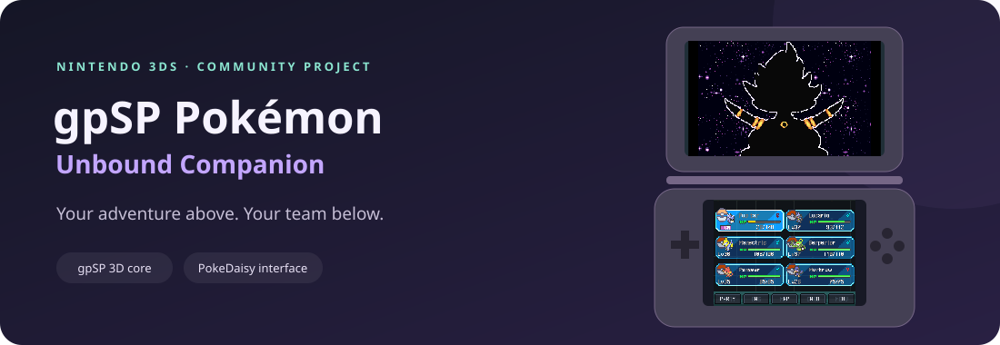

<p align="center">
  
</p>

<p align="center">
  <a href="LICENSE"></a>
  
  
  
</p>

<p align="center">
  <b>Play Pokémon Unbound on the top screen. Keep your team, bag and map within reach below.</b><br>
  Powered by <a href="https://github.com/bheppe/gpsp-3d">gpSP 3D</a> and the portable companion interface from <a href="https://github.com/lidor30/pokedaisy">PokeDaisy</a>.
</p>

<p align="center">
  <a href="#installation">Installation</a> ·
  <a href="#the-bottom-screen">Features</a> ·
  <a href="#saves-and-settings">Saves &amp; settings</a> ·
  <a href="#building">Build</a> ·
  <a href="README_COMPANION_UK.md">Українською</a> ·
  <a href="README_ES.md">Español</a>
</p>

---

## Screenshots

<p align="center">
  <br>
  
</p>

<p align="center"><sub>Top screen: Pokémon Unbound · Bottom screen: the PokeDaisy party tab in dark mode.<br>Captured on November 16, 2026. Game artwork belongs to its respective owners.</sub></p>

## The bottom screen

A companion for **Pokémon Unbound 2.1.1.1 English and ES v1.08**, designed for Nintendo 3DS, including Old 3DS in 2D. The game runs through gpSP's ARM11 JIT; the companion reads game data to display useful information while you play.

| Tab | What you can see |
| --- | --- |
| **PARTY** | Your team, levels, HP, status, moves, PP and Pokémon details. |
| **BAG** | Bag pockets, item quantities, names and descriptions. |
| **MAP** | The Borrius map, your position and places. |
| **CARD** | A PokeDaisy trainer card with front/back views. |
| **MENU** | The original gpSP settings, saves and emulator controls. |

Choose a **light or dark companion theme**, set bottom-screen artwork to **Nearest or Smooth**, and keep gpSP's display, audio, button mapping and save-state controls. Companion tabs are read-only: item use, trading, party editing and Fly are not implemented.

The app uses **one HOME Menu CIA**. Choose your ROM once; later launches open it automatically. Prepared ROM data is cached to speed up subsequent starts.

> **Experimental build:** hardware behavior and performance depend on the console, game scene and settings. Trainer-card badges are currently unavailable. The banner uses the same game and companion captures shown above.

> **Spanish preview:** this branch adds ES v1.08 ROM support and an English / Español interface switch. Hardware validation is pending. See [Spanish testing notes](docs/SPANISH_SUPPORT_UK.md).

## Installation

You need a homebrew-enabled Nintendo 3DS and your own **Pokémon Unbound 2.1.1.1 English or the supported ES v1.08** ROM.

1. Install `unbound-dual.cia` using FBI. For Homebrew Launcher, copy `unbound-dual.3dsx` to your SD card instead.
2. Open **Unbound Dual** and select your ROM on the first launch.
3. Let the initial data preparation finish. The first preparation takes longer; later starts can reuse cached data.
4. Continue your game using **Continue** in Unbound. Automatic ROM startup does not automatically restore a save state.

To choose a different ROM, open **MENU → System → Unbound ROM**. A missing or moved ROM opens the picker again.

<details>
<summary>ROM identity and application details</summary>

| Item | Value |
| --- | --- |
| Supported game | Pokémon Unbound 2.1.1.1, English |
| English ROM SHA-1 | `b4776b82a4c7915d0fadeaa27e013523f99dfd94` |
| Application Title ID | `000400000BAC8200` |
| Companion CIA version | `0.0.6` (ES test) |
| Base emulator | gpSP 3D v0.1.7 |

ROMs, Nintendo's BIOS and saves are not included. The open source BIOS replacement inherited from gpSP is supplied with its source under `bios/`.

</details>

## Saves and settings

**Your saves are managed by gpSP.** Open **MENU → System → Save file** to see the active save location. Save files and save states are separate; keep a backup of your save before moving or renaming the ROM.

| Setting | Where to find it |
| --- | --- |
| Interface language | **MENU → Display → Interface language** |
| Companion theme | **MENU → Display → Companion theme** |
| Bottom artwork filtering | **MENU → Display → Companion filtering** |
| Game scaling | **MENU → Display → Scaling** |
| Screen size | **MENU → Display → Screen size** |
| Selected ROM | **MENU → System → Unbound ROM** |

The companion configuration is stored at `sdmc:/3ds/gpsp3d/companion-gpsp3d.cfg`. Cached preparation data lives under `sdmc:/3ds/gpsp3d/companion-cache/`. The companion reads game data and does not edit your party or write its own game saves.

For more detail, see the [Ukrainian usage guide](README_COMPANION_UK.md).

## Building

Use Linux or WSL with **Docker**, **Git** and **Python 3**. The Docker daemon must be running and accessible to your user. The first build needs Internet access for the toolchain image and CIA tools.

From the repository root:

```sh
make -C 3ds 3ds
python3 gpsp3ds/companion/test/verify_cia.py gpsp3ds/out
```

Outputs:

```text
gpsp3ds/out/
├── unbound-dual.cia
└── unbound-dual.3dsx
```

The build produces only the PokeDaisy companion. It uses devkitARM, libctru and citro3d from `devkitpro/devkitarm:latest`, plus makerom **0.18.4** and bannertool **1.2.2**. The Docker toolchain is not fully pinned. Build commands are in [`gpsp3ds/build-companion.sh`](gpsp3ds/build-companion.sh).

GitHub Actions provides a manual build and builds pushes to `main`; successful runs upload the companion artifacts and licensing notices. A release binary should be distributed with the corresponding source revision.

<details>
<summary>Host checks and source layout</summary>

The fixture checks require a separate [PokeDaisy checkout](https://github.com/lidor30/pokedaisy):

```sh
bash gpsp3ds/companion/test/run.sh /path/to/pokedaisy/app/src/test/resources/fixtures
```

These checks cover RAM readers, touch actions, allocation cleanup, caching and bottom scaling. They do not emulate 3DS hardware or measure in-game FPS.

| Path | Purpose |
| --- | --- |
| Repository root | gpSP core and rendering code |
| `gpsp3ds/source/` | Nintendo 3DS frontend and emulator menu |
| `gpsp3ds/companion/` | Companion adapter, cache and UI integration |
| `gpsp3ds/companion/vendor/` | Imported and adapted PokeDaisy components |

See [AGENTS.md](AGENTS.md) and [README_AI_UK.md](README_AI_UK.md) for development context.

</details>

## Credits and license

**Based on PokeDaisy by Lidor Itzhari - https://github.com/lidor30/pokedaisy**

This community fork is maintained by **slickmaxim**. Thanks to **bheppe and the gpSP 3D contributors**, **Exophase and the gpSP contributors**, and **Lidor Itzhari** for the emulator and companion foundations.

The combined application is distributed under **GNU GPL version 3**, with PokeDaisy's attribution requirement. Read [LICENSE](LICENSE), [NOTICE](NOTICE) and [THIRD_PARTY_NOTICES.md](THIRD_PARTY_NOTICES.md). Individual components retain their original licenses, including gpSP's GPL notices, mGBA GPU code under MPL-2.0 and Inter under OFL-1.1.

This is an unofficial fan project, unaffiliated with the original projects, Nintendo, Game Freak or The Pokémon Company. Pokémon names and artwork belong to their respective owners. No game ROMs, extracted game art, saves or crash dumps are included in this repository.

Spanish ES v1.08 SHA-1: `d5b312465c0a95bcb6428bd61cc170994a2a65fc`. Other Spanish builds are not yet supported.
