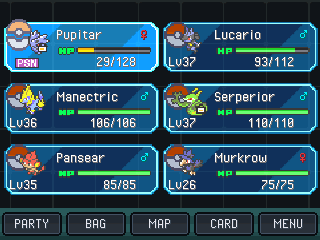

<p align="center">
  
</p>

<p align="center">
  <a href="LICENSE"></a>
  
  
  
</p>

<p align="center">
  <b>Play Pokémon Unbound on the top screen. Keep your team, bag and map within reach below.</b><br>
  Speed through battles with fast forward and return to a saved moment with save states.<br>
  Powered by <a href="https://github.com/bheppe/gpsp-3d">gpSP 3D</a> and the portable companion interface from <a href="https://github.com/lidor30/pokedaisy">PokeDaisy</a>.
</p>

<p align="center">
  <a href="#installation">Installation</a> ·
  <a href="#the-bottom-screen">Features</a> ·
  <a href="#whats-new-in-v021">What’s new</a> ·
  <a href="#saves-and-settings">Saves &amp; settings</a> ·
  <a href="#building">Build</a> ·
  <a href="README_COMPANION_UK.md">Українською</a> ·
  <a href="README_ES.md">Español</a>
</p>

---

## Screenshots

<p align="center">
  <br>
  
</p>

<p align="center"><sub>Top screen: Pokémon Unbound · Bottom screen: the PokeDaisy party tab in dark mode.<br>Captured on November 16, 2026. Game artwork belongs to its respective owners.</sub></p>

## The bottom screen

A companion for **Pokémon Unbound** in English and supported Spanish and Russian builds, designed for Nintendo 3DS, including Old 3DS in 2D. The game runs through gpSP's ARM11 JIT; the companion reads game data to display useful information while you play.

| Tab | What you can see |
| --- | --- |
| **PARTY** | Your team, levels, HP, status, moves, PP and Pokémon details. |
| **BAG** | Bag pockets, item quantities, names and descriptions. Use supported items right from the bag. |
| **MAP** | The Borrius map, your position and places. |
| **CARD** | A PokeDaisy trainer card with front/back views. |
| **MENU** | The original gpSP settings, fast forward and save states. |

Choose a **light or dark companion theme**, set bottom-screen artwork to **Nearest or Smooth**, and adjust gpSP’s display, audio and button settings.

The app uses **one HOME Menu CIA**. Choose your ROM once; later launches open it automatically. Prepared ROM data is cached to speed up subsequent starts.

> **Experimental build:** hardware behavior and performance depend on the console, game scene and settings. Trainer-card badges are currently unavailable. The banner uses the same game and companion captures shown above.

## What's new in v0.2.1

v0.2.1 includes the improvements tested in Test 17, along with a release you can install from the app.

- **More languages.** Three Spanish ROM builds and the Russian P.E. patch are supported, including their Party graphics. Choose English, Español or Русский for the app interface under **MENU → Display → Interface language**.
- **Smoother bag scrolling.** The item list and scrollbar redraw as you scroll, on a schedule that targets 30 updates per second.
- **Use items from the bag.** While in the field, select a supported medicine, berry or PP item and tap **Use** to choose a Pokémon. Supported TMs and HMs open the teaching screen in the game.
- **Fast-forward indicator.** Use 2×, 3× or 4×. The active speed appears in the top-right corner of the game screen.
- **Updates from the app.** With Wi-Fi and **Check for updates** enabled, Unbound Dual checks its public GitHub releases at startup. When a newer stable version is available, choose **Update** to download and install it or **Later** to continue. You can also install it from **System → Install update**. This works with CIA and 3DSX installations.
- **GPU startup fix.** This release addresses the black screen reported with GPU Display enabled. Hold **L** while starting the app to use CPU display if you encounter it.

The reported input issue after waking the console from sleep remains open. [Changes since v0.1.1](https://github.com/Slickmaxim/unbound-dual/compare/v0.1.1...v0.2.1)

## Installation

You need a homebrew-enabled Nintendo 3DS and your own copy of a supported **Pokémon Unbound** ROM. See the list below for the exact builds.

1. Get `unbound-dual.cia` or `unbound-dual.3dsx` from [GitHub Releases](https://github.com/Slickmaxim/unbound-dual/releases/latest). Install `unbound-dual.cia` using FBI. For Homebrew Launcher, copy `unbound-dual.3dsx` to your SD card instead.
2. Open **Unbound Dual** and select your ROM on the first launch.
3. Let the initial data preparation finish. The first preparation takes longer; later starts can reuse cached data.
4. Continue your game using **Continue** in Unbound. Automatic ROM startup does not automatically restore a save state.

To choose a different ROM, open **MENU → System → Unbound ROM**. A missing or moved ROM opens the picker again.

<details>
<summary>ROM identity and application details</summary>

| Item | Value |
| --- | --- |
| Application Title ID | `000400000BAC8200` |
| Companion CIA version | `0.1.7` |
| Base emulator | gpSP 3D v0.1.7 |

| Supported ROM | SHA-1 |
| --- | --- |
| Unbound 2.1.1.1 English | `b4776b82a4c7915d0fadeaa27e013523f99dfd94` |
| Unbound ES v1.08 | `d5b312465c0a95bcb6428bd61cc170994a2a65fc` |
| Unbound ES v1.08 sinza | `117449bd7822fad0db293a4f7e364787e4f8543a` |
| Unbound ES 2.1.1.1 | `1104054a3061b35b85b04757fbca5a3686cca60c` |
| Unbound RU 2.1.1.1 (P.E.) | `87d1485eaa64e242d39874add766a34f46cd9b32` |

To prepare the Russian ROM, follow the [P.E. patch instructions](https://github.com/PEdeveloper/pokemon-unbound-ru).

ROMs, Nintendo's BIOS and saves are not included. The open source BIOS replacement inherited from gpSP is supplied with its source under `bios/`.

</details>

## Saves and settings

**Your saves are managed by gpSP.** Open **MENU → System → Save file** to see the active location of your regular game save. Keep a backup before moving or renaming the ROM.

**Save states.** Open **MENU → Game**, choose a **State slot**, then use **Save state** to capture the current moment or **Load state** to return to it. Use Pokémon Unbound’s own Save menu for your regular game save.

**Fast forward.** The default button is **Y**. Open **MENU → Speed** to select a multiplier and choose whether to hold the button or tap it to toggle.

| Setting | Where to find it |
| --- | --- |
| Interface language | **MENU → Display → Interface language** |
| Companion theme | **MENU → Display → Companion theme** |
| Bottom artwork filtering | **MENU → Display → Companion filtering** |
| Game scaling | **MENU → Display → Scaling** |
| Screen size | **MENU → Display → Screen size** |
| Selected ROM | **MENU → System → Unbound ROM** |

The companion configuration is stored at `sdmc:/3ds/gpsp3d/companion-gpsp3d.cfg`. Cached preparation data lives under `sdmc:/3ds/gpsp3d/companion-cache/`.

For more detail, see the [Ukrainian usage guide](README_COMPANION_UK.md).

## Building

Use Linux or WSL with **Docker**, **Git** and **Python 3**. The Docker daemon must be running and accessible to your user. The first build needs Internet access for the toolchain image and CIA tools.

From the repository root:

```sh
make -C 3ds 3ds
python3 gpsp3ds/companion/test/verify_cia.py gpsp3ds/out
```

Outputs:

```text
gpsp3ds/out/
├── unbound-dual.cia
└── unbound-dual.3dsx
```

The build produces only the PokeDaisy companion. It uses devkitARM, libctru and citro3d from `devkitpro/devkitarm:latest`, plus makerom **0.18.4** and bannertool **1.2.2**. The Docker toolchain is not fully pinned. Build commands are in [`gpsp3ds/build-companion.sh`](gpsp3ds/build-companion.sh).

The GitHub Actions workflow runs on pull requests and pushes to `main`. You can also run it manually. It packages the binaries with their licensing notices.

<details>
<summary>Host checks and source layout</summary>

The fixture checks require a separate [PokeDaisy checkout](https://github.com/lidor30/pokedaisy):

```sh
bash gpsp3ds/companion/test/run.sh /path/to/pokedaisy/app/src/test/resources/fixtures
```

These checks cover RAM readers, touch actions, allocation cleanup, caching and bottom scaling. They do not emulate 3DS hardware or measure in-game FPS.

| Path | Purpose |
| --- | --- |
| Repository root | gpSP core and rendering code |
| `gpsp3ds/source/` | Nintendo 3DS frontend and emulator menu |
| `gpsp3ds/companion/` | Companion adapter, cache and UI integration |
| `gpsp3ds/companion/vendor/` | Imported and adapted PokeDaisy components |

See [AGENTS.md](AGENTS.md) and [README_AI_UK.md](README_AI_UK.md) for development context.

</details>

## Credits and license

**Based on PokeDaisy by Lidor Itzhari - https://github.com/lidor30/pokedaisy**

This community fork is maintained by **slickmaxim**. Thanks to **bheppe and the gpSP 3D contributors**, **Exophase and the gpSP contributors**, and **Lidor Itzhari** for the emulator and companion foundations.

The combined application is distributed under **GNU GPL version 3**, with PokeDaisy's attribution requirement. Read [LICENSE](LICENSE), [NOTICE](NOTICE) and [THIRD_PARTY_NOTICES.md](THIRD_PARTY_NOTICES.md). Individual components retain their original licenses, including gpSP's GPL notices, mGBA GPU code under MPL-2.0 and Inter under OFL-1.1.

This is an unofficial fan project, unaffiliated with the original projects, Nintendo, Game Freak or The Pokémon Company. Pokémon names and artwork belong to their respective owners. No game ROMs, extracted game art, saves or crash dumps are included in this repository.
